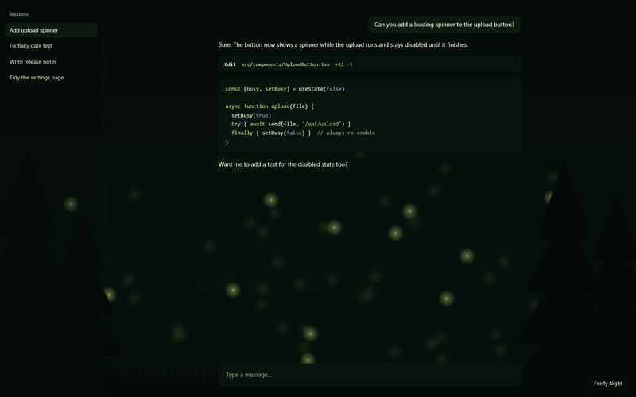
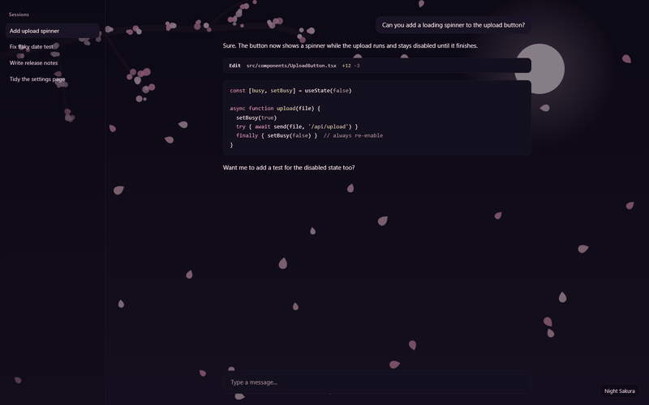
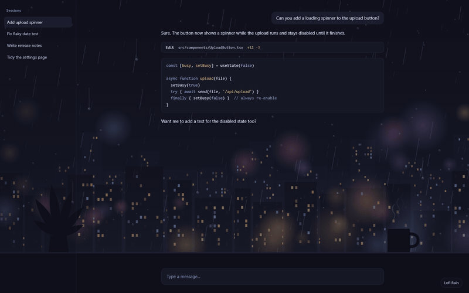
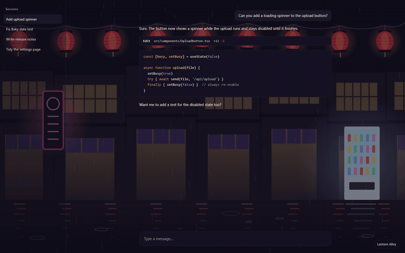
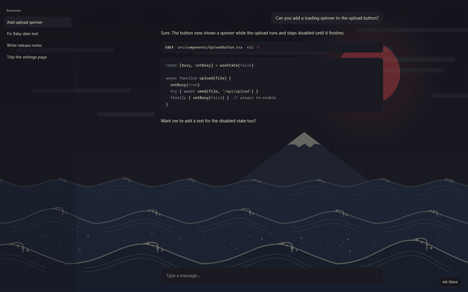

# Claude Code themes from ClaudeFolio

Sixteen themes for the Claude Code desktop app. Fifteen paint the app dark and play a moving scene behind your conversation; one, Clean Slate, is a calm light theme where nothing moves. They are built to stay light, so the app's CPU use stays close to idle. Designed by ClaudeFolio together with Claude.

| | |
|---|---|
| <br>**Digital Rain**: Matrix-style digital rain, green code falling in two layers | <br>**Neon Horizon**: a striped sun and a grid rolling toward you |
| <br>**Braille Stars**: twinkling braille-dot stars and a shooting star | <br>**Firefly Night**: fireflies blinking at the edge of a pine forest |
| <br>**Amber Terminal**: log lines scrolling up an old amber CRT | <br>**Night Sakura**: petals tumbling past a moonlit branch |
| <br>**Lofi Rain**: a lofi rainy window, city lights, and a steaming mug | <br>**Pastel Nebula**: pastel clouds, a ringed planet, and shooting stars |
| <br>**Lantern Alley**: paper lanterns swaying over a rainy Japanese street | <br>**Pixel Camp**: a pixel-art campfire, a lit tent, and a blinking owl |
| <br>**Ink Wave**: woodblock-print waves rolling past a red sun | <br>**Fireside**: a crackling hearth, snow at the window, and a sleeping cat |
| <br>**Rooftop Santa**: Santa waving from a snowy rooftop beside the chimney | <br>**Sleigh Ride**: reindeer pull the sleigh across the moon, the lead one's red nose glowing |
| <br>**Holiday Lights**: string lights, a lit pine and falling snow | <br>**Clean Slate**: white and soft gray, nothing moving |

The chat in these previews is made up, to show the colors.

## Install

In Claude Code, run:

```
/plugin install digital-rain --marketplace claudefoliothemes/claude-code-themes
```

Swap `digital-rain` for any theme: `braille-stars`, `neon-horizon`, `firefly-night`, `amber-terminal`, `night-sakura`, `holiday-lights`, `rooftop-santa`, `sleigh-ride`, `lofi-rain`, `lantern-alley`, `pastel-nebula`, `ink-wave`, `fireside`, `pixel-camp`, or `clean-slate`. Answer `y` to add the marketplace, then pick the user scope so the theme follows you into every session.

Run one theme at a time. Every theme sets the whole look, so whichever loads last wins. To switch, turn one off and another on:

```
claude plugin disable digital-rain@claudefolio-themes
```

```
claude plugin enable neon-horizon@claudefolio-themes
```

## What you need

- The Claude desktop app (Code tab) or the Claude mobile app. The terminal keeps its own look.
- Claude Code 2.1.324 or later.
- Dark mode for every theme except Clean Slate, which needs light mode.
- **Windows:** turn on Settings > Personalization > Colors > **Transparency effects**. With it off, the app makes its glass fully opaque and hides the scene, so you see the colors but no backdrop.
- **macOS:** turn off System Settings > Accessibility > Display > **Reduce transparency**, for the same reason.

## Light on your CPU

A backdrop repaints the whole window every time anything in it changes. So every scene here moves on a shared beat (a tenth of a second, or slower), and the window repaints a few times a second at most, however many things are moving. Nothing animates smoothly 60 times a second.

Measured in headless Chrome at 1920x1080, averaged over 12 seconds. An empty page measured about 0.15 to 0.2 CPU cores.

| Theme | CPU cores |
|---|---|
| Digital Rain | 0.44 |
| Neon Horizon | 0.32 |
| Braille Stars | 0.29 |
| Ink Wave | 0.29 |
| Lofi Rain | 0.28 |
| Pastel Nebula | 0.26 |
| Firefly Night | 0.26 |
| Amber Terminal | 0.25 |
| Holiday Lights | 0.25 |
| Sleigh Ride | 0.25 |
| Rooftop Santa | 0.21 |
| Lantern Alley | 0.20 |
| Pixel Camp | 0.19 |
| Fireside | 0.18 |
| Night Sakura | 0.17 |
| Clean Slate | nothing moves |

If your system asks apps to reduce motion, every scene holds still.

## Troubleshooting

**The colors changed but there's no backdrop.** Check the transparency setting under "What you need".

**The backdrop shows but doesn't move.** Some app builds freeze a scene whose SVG holds an `@media` rule (other than reduced motion) or `shape-rendering`. These themes use neither. Some builds also freeze a mod loaded straight from a folder, so install from this marketplace rather than with `--plugin-dir`.

**Typing feels slow.** Try a lighter theme from the table, and tell us which one lagged.

## Make your own

The scenes are plain SVG built by small scripts in `tools/scenes/`, and one build script turns each into a mod, from the palettes in `tools/themes.config.mjs`:

```
node tools/build-themes.mjs --out themes
```

`tools/render-previews.mjs` renders the previews. It needs Chrome and an ffmpeg with libx264.

Themes install from zips on the [GitHub releases](https://github.com/claudefoliothemes/claude-code-themes/releases), so each zip's download count shows how often that theme is installed. `node tools/release-themes.mjs --publish` builds the zips, uploads any new ones, and points the marketplace at them. It needs a `GITHUB_TOKEN` with write access to the repo. An uploaded zip is never replaced: to ship a change, bump `VERSION` in `tools/themes.config.mjs` and rebuild.

## License

MIT. See [LICENSE](LICENSE).

ClaudeFolio is not affiliated with Anthropic. Claude and Claude Code are trademarks of Anthropic.
