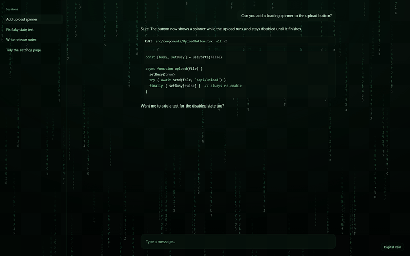
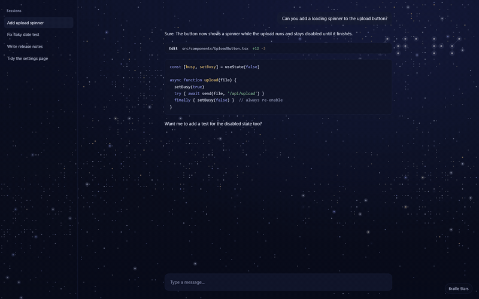

# Claude Code themes from ClaudeFolio

Six animated themes for the Claude Code desktop app. Each one paints the app in a dark palette and draws a moving scene behind your conversation. They are built to stay light: each one keeps the app's CPU use close to idle.

| | |
|---|---|
| <br>**Digital Rain**: green glyph columns falling in two layers | <br>**Neon Horizon**: a striped sun and a grid rolling toward you |
| <br>**Braille Stars**: twinkling braille-dot stars and a shooting star | <br>**Firefly Night**: fireflies blinking at the edge of a pine forest |
| <br>**Amber Terminal**: log lines scrolling up an old amber CRT | <br>**Night Sakura**: petals tumbling past a moonlit branch |

The chat in these previews is made up, to show the colors.

## Install

In Claude Code, run:

```
/plugin install digital-rain --marketplace claudefoliothemes/claude-code-themes
```

Swap `digital-rain` for any theme: `braille-stars`, `neon-horizon`, `firefly-night`, `amber-terminal` or `night-sakura`. Answer `y` to add the marketplace, then pick the user scope so the theme follows you into every session.

Run one theme at a time. Every theme sets the whole look, so whichever loads last wins. To switch, turn one off and another on:

```
claude plugin disable digital-rain@claudefolio-themes
```

```
claude plugin enable neon-horizon@claudefolio-themes
```

## What you need

- The Claude desktop app (Code tab) or the Claude mobile app. The terminal keeps its own look.
- Claude Code 2.1.324 or later.
- Dark mode. These are dark themes.
- **Windows:** turn on Settings > Personalization > Colors > **Transparency effects**. With it off, the app makes its glass fully opaque and hides the scene, so you see the colors but no backdrop.
- **macOS:** turn off System Settings > Accessibility > Display > **Reduce transparency**, for the same reason.

## Light on your CPU

A backdrop repaints the whole window every time anything in it changes. So every scene here moves on a shared beat (a tenth of a second, or slower), and the window repaints a few times a second at most, however many things are moving. Nothing animates smoothly 60 times a second.

Measured in headless Chrome at 1920x1080, averaged over 12 seconds. An empty page measured about 0.15 to 0.2 CPU cores.

| Theme | CPU cores |
|---|---|
| Digital Rain | 0.44 |
| Neon Horizon | 0.32 |
| Braille Stars | 0.29 |
| Firefly Night | 0.29 |
| Amber Terminal | 0.25 |
| Night Sakura | 0.17 |

If your system asks apps to reduce motion, every scene holds still.

## Troubleshooting

**The colors changed but there's no backdrop.** Check the transparency setting under "What you need".

**The backdrop shows but doesn't move.** Some app builds freeze a scene whose SVG holds an `@media` rule (other than reduced motion) or `shape-rendering`. These themes use neither. Some builds also freeze a mod loaded straight from a folder, so install from this marketplace rather than with `--plugin-dir`.

**Typing feels slow.** Try a lighter theme from the table, and tell us which one lagged.

## Make your own

The scenes are plain SVG built by small scripts in `tools/scenes/`, and one build script turns each into a mod:

```
node tools/build-themes.mjs --out themes
```

`tools/render-previews.mjs` renders the previews. It needs Chrome and an ffmpeg with libx264.

## License

MIT. See [LICENSE](LICENSE).

ClaudeFolio is not affiliated with Anthropic. Claude and Claude Code are trademarks of Anthropic.
